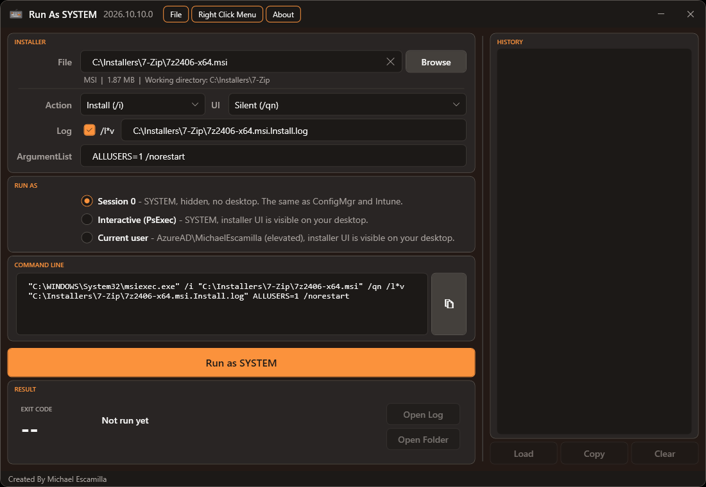
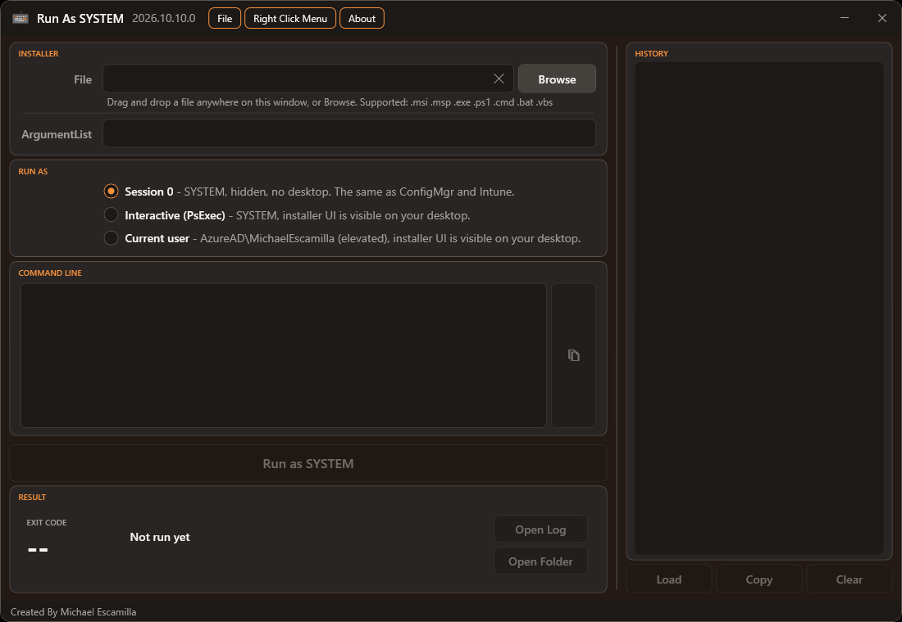
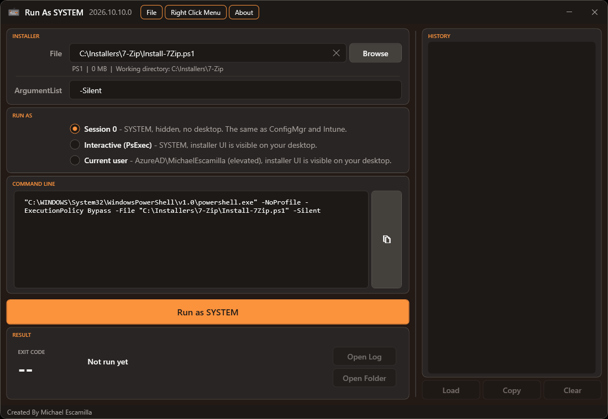

# RunAsSystem
Run MSI, EXE and script installers as **NT AUTHORITY\SYSTEM** to test an installation the same way ConfigMgr and Intune run it, without downloading PsExec or remembering its switches.<br>

Select or drag and drop an installer, set the arguments and click **Run as SYSTEM**. The exit code and what it means are shown when the installer finishes.



## Quick Access
Run the script directly from GitHub:

### Invoke-Expression
```powershell
iex (irm runassystem.michaeltheadmin.com)
```

The app needs administrator rights. If it isn't started elevated, it relaunches itself and shows a UAC prompt.

## Screenshots
When it opens, the app is ready for you to drag and drop or browse for an installer:



An MSI shows Windows Installer options (action, UI level and a verbose log). The **Command Line** box shows exactly what will run:


A PowerShell script runs with Windows PowerShell 5.1, the same as Intune and ConfigMgr:



## Credits
- **[Ben Whitmore](https://github.com/byteben)** and **[Patch My PC](https://patchmypc.com)**: Ben's [Patch My PC Connectivity tool](https://github.com/PatchMyPCTeam/CustomerTroubleshooting/tree/Release/PowerShell/Connectivity) inspired RunAsSystem. It showed that an installer can run as SYSTEM in Session 0 through a one-time Scheduled Task, without PsExec. Session 0 mode is based on that approach. RunAsSystem adds a GUI, exit code descriptions, run history and a right-click menu.
- [PsExec](https://learn.microsoft.com/sysinternals/downloads/psexec) by Sysinternals, for Interactive mode.

Thanks to Ben and the Patch My PC team for sharing their work.

## Run Modes
### Session 0 (default)
The installer runs as SYSTEM in **session 0**, which has no desktop. This is how the ConfigMgr client and the Intune Management Extension run installers, so it's the most accurate test. Problems this mode catches:
- Installers that stop at a prompt or dialog nobody can see. In ConfigMgr and Intune these hang until they time out.
- Installers that depend on the logged-on user's profile, environment variables or mapped drives.

No PsExec is needed. A one-time Scheduled Task, based on the approach [Ben Whitmore](https://github.com/byteben) used in the [Patch My PC Connectivity tool](https://github.com/PatchMyPCTeam/CustomerTroubleshooting/tree/Release/PowerShell/Connectivity), runs the installer directly:
- The task is registered in the root of the Task Scheduler Library as `RunAsSystem_<timestamp>`.
- It runs as `S-1-5-18` with highest privileges at normal priority. Scheduled tasks default to below-normal priority, which would make installs run slower than they do in ConfigMgr or Intune.
- It has no active trigger, so it only runs when the tool starts it. It has no time limit, and its working directory is the installer's own folder.
- The installer's exit code becomes the task's *Last Run Result*, which is how the tool reads it.
- The task is deleted as soon as the run finishes. If the app is closed mid-run, the task expires and deletes itself after 24 hours, and the next launch of the app removes it anyway.

### Interactive (PsExec)
The installer runs as SYSTEM **on your desktop**, so any installer UI is visible. This is useful for working out why a silent install hangs.

The tool looks for `PsExec64.exe` (or `PsExec.exe`) in `%LOCALAPPDATA%\RunAsSystem\PsExec` first, then on the `PATH`. If it isn't found, the tool offers to download it from [live.sysinternals.com](https://live.sysinternals.com) into `%LOCALAPPDATA%\RunAsSystem\PsExec`.

### Current User
The installer runs as **the account running RunAsSystem**, on your desktop, with the same elevation as RunAsSystem. Because the app always runs elevated, this normally means elevated. The option shows the account and its elevation, for example *ESKIMOLED\Eskim (elevated)*.

It uses the same one-time Scheduled Task as Session 0 mode, registered for your account with an interactive token, so no password is needed. That means the exit code, cleanup and **Stop** work the same way.

Things to know:
- Intune and ConfigMgr run user-context installs **without** elevation, so this mode isn't an exact match for their user context. An installer that quietly needs admin rights will still succeed here.
- If you elevated RunAsSystem with a **different** admin account than the one you're signed in with, the installer runs as that admin account, not as you. An interactive task may not start at all for an account that isn't signed in to Windows. If it doesn't start within 30 seconds, the tool says so.

## Supported File Types
| Type | Runs as |
| --- | --- |
| `.msi` | `msiexec.exe /i` (or `/x`, `/fvomus`) `"file.msi"` + UI level, `/l*v` log and properties |
| `.msp` | `msiexec.exe /p "file.msp"` + the same options |
| `.exe` | The file itself, with your arguments |
| `.ps1` | `powershell.exe -NoProfile -ExecutionPolicy Bypass -File "file.ps1"` + arguments |
| `.cmd` / `.bat` | `cmd.exe /c ""file.cmd" arguments"` |
| `.vbs` | `cscript.exe //NoLogo "file.vbs"` + arguments |

The installer's own folder is always used as the working directory, the same as ConfigMgr and Intune.

## MSI Options
- **Action**: Install (`/i`), Uninstall (`/x`) or Repair (`/fvomus`).
- **UI**: Silent (`/qn`), Basic (`/qb`), Basic with no cancel (`/qb!`), Passive (`/passive`) or Full UI.
- **Log**: a verbose log (`/l*v`) is on by default. It's written next to the installer, named after the installer and the action: `Setup.msi.Install.log`, `Setup.msi.Uninstall.log`, `Setup.msi.Repair.log`, or `Update.msp.Patch.log` for a patch. Changing the action updates the name, unless you've typed your own path.
- **ArgumentList**: anything else to pass to msiexec, such as `ALLUSERS=1 TRANSFORMS="app.mst"` or `/norestart`.

The **Command Line** box shows exactly what will run, and you can copy it with the copy button.

## Variables in ArgumentList
EXE installers each have their own log switch, so there's no log checkbox for them. Instead, the line under ArgumentList has variables you can click to insert at the cursor. They're filled in when the installer runs:

| Variable | Becomes |
| --- | --- |
| `{LogFile}` | A log file next to the installer: `C:\Pkgs\Setup.exe.log` |
| `{InstallerDir}` | The installer's folder, without a trailing backslash: `C:\Pkgs` |
| `{InstallerName}` | The installer's file name, with its extension: `Setup.exe` |

For example, `/log "{LogFile}"` for a WiX Burn bundle, `/LOG="{LogFile}"` for Inno Setup, or `/log "{InstallerDir}\{InstallerName}.Uninstall.log"` for your own name. The extension is kept so the logs of a product's EXE and MSI installers don't mix.
- These only fill in a path. The installer writes a log only if you pass the path with its own log switch, so check the vendor's documentation.
- When `{LogFile}` is in the arguments, **Open Log** opens that file once the installer creates it, the same as an MSI log. A path built from `{InstallerDir}` and `{InstallerName}` isn't followed.
- The Command Line box shows the values filled in. **Copy arguments** copies just the arguments with the values filled in.
- History saves the variables as you typed them, so loading a run works out the paths again.

## Stopping a Run
While a run is in progress, a **Stop** button appears next to Run. It works the same way for every file type and in both Session 0 and PsExec modes. It ends the running process and anything it started, and records the run as **Stopped** in history. Stopping a process partway through can leave the software partly installed.

**MSI installs can't be stopped this way**, and neither can an MSI started by an EXE. The install runs in the Windows Installer service, not in the `msiexec.exe` process the tool starts. Windows Installer finishes the install in the background and keeps writing the log, and RunAsSystem just stops waiting. Starting another MSI before it finishes returns `1618`. Uninstall afterwards if you need to undo it.

## Exit Codes
When the run finishes, the exit code is shown in colour:
- **Green**: success (`0`, `1707`).
- **Orange**: success with a restart required or started (`3010`, `1641`).
- **Red**: failure.

Common Windows Installer codes (`1603`, `1618`, `1619`, `1638`, and others) have plain-English descriptions. Any other code falls back to the description Windows has for that number. The hex value is shown under the code (for example `0x80070002`), which is handy for EXE installers that document their codes in hex.

## History
Every run is saved to `%LOCALAPPDATA%\RunAsSystem\History.json`. It keeps the last 50 runs, including runs launched with `iex`.
- Each entry shows the file, exit code, time, run mode and arguments.
- **Load** (or double-click a run, or the load icon that appears when you hover over a run) puts the file, options, arguments and run mode back into the form, ready to run again.
- **Copy** (or the copy icon on hover) copies the run's command line.
- **Clear** empties the history.

Arguments can contain passwords or license keys, so the arguments and command line are encrypted with Windows DPAPI. Only your Windows account on that device can read them. If you copy `History.json` to another device, the runs still appear, but their arguments can't be loaded. Those entries show a warning icon.

## Keyboard Shortcuts
| Shortcut | Action |
| --- | --- |
| `Ctrl+Enter` or `F5` | Run as SYSTEM |
| `Ctrl+O` | Browse for an installer |
| `Ctrl+L` | Load the selected history entry |
| `Ctrl+R` | Reset: clear the file, options and result, as if the tool had just opened (same as the ✕ in the File box) |

## Drag and Drop While Elevated
Windows normally blocks drag and drop from Explorer into an elevated window, which is why GetMSIInformation asks you not to run it as administrator. RunAsSystem lets the older `WM_DROPFILES` message through the window's message filter, so drag and drop still works while elevated. You can also paste a path or use **Browse**.

## Right-Click Context Menu Option
Install a **Run as SYSTEM...** option for `.msi`, `.msp`, `.exe`, `.ps1`, `.cmd`, `.bat` and `.vbs` files from the **Right Click Menu** menu. The option shows the UAC shield and opens the app with the file already loaded. It opens the app in PowerShell 7.4 or later when that's installed, and in Windows PowerShell 5.1 otherwise. If you install PowerShell 7 later, reinstall the menu to switch to it.

- **Install**: copies the script and icon to `%LOCALAPPDATA%\RunAsSystem\ContextMenu` and registers the menu under `HKCU\Software\Classes\SystemFileAssociations`.
- **Uninstall**: removes the menu and its files. Your run history is kept.
- **Open Right Click Menu Folder**: opens the folder used by the menu.

## Command Line Parameters
```powershell
.\RunAsSystem.ps1 -FilePath "C:\Installers\Setup.msi" -Arguments "ALLUSERS=1"
```
| Parameter | Description |
| --- | --- |
| `-FilePath` | Installer to load when the app opens |
| `-Arguments` | Text to pre-fill in the ArgumentList box |

## Things to Know About SYSTEM
- **Network paths**: SYSTEM connects to shares as the computer account (`DOMAIN\COMPUTER$`). The share needs to allow read access for it, and write access too if the MSI log is written there. The app warns you when the installer is on a network path.
- **Mapped drives**: drive letters you mapped in your normal session aren't available to elevated apps or to SYSTEM. Use the UNC path instead.
- **Session 0 has no UI**: if an installer waits for input in Session 0, it waits forever. Switch to **Interactive (PsExec)** to see what it's waiting for.

## Updates
The app checks GitHub for a newer release after it opens. If one exists, an **Update Available** item appears in the menu bar. **About > Check for Updates** checks again on demand.

Clicking **Update Available** installs the update and reopens the app with the same file loaded:

- **Downloaded script or right-click menu copy**: the script file is replaced with the new release.
- **Installed from the PowerShell Gallery**: the app runs `Update-Script RunAsSystem`.
- **Launched with `iex (irm ...)`**: the release page opens. Nothing is saved on disk, and the next launch is already the latest.

If the update can't be installed (you're offline, the file is locked or the download is damaged), the release page opens instead. You can't update while an installer is running.

## Requirements
- Windows PowerShell 5.1, or PowerShell 7. When the app relaunches as administrator or after an update, it uses the same PowerShell you started it in. The right-click menu uses PowerShell 7.4+ when it's installed.
- Administrator rights
- Internet access only for the update check and the optional PsExec download
