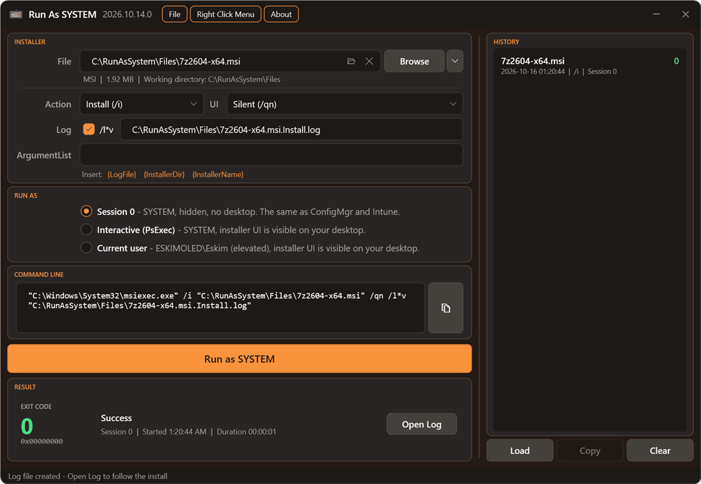

# RunAsSystem

Run MSI, EXE and script installers as **NT AUTHORITY\SYSTEM** to test an installation the same way ConfigMgr and Intune run it, without downloading PsExec or remembering its switches.

Select or drag and drop an installer, set the arguments and click **Run as SYSTEM**. The exit code and what it means are shown when the installer finishes.



## Quick Access

Run it straight from GitHub, or install it from the PowerShell Gallery:

### Invoke-Expression

```powershell
iex (irm runassystem.michaeltheadmin.com)
```

### PowerShell Gallery

```powershell
Install-Script -Name RunAsSystem
RunAsSystem.ps1
```

The app needs administrator rights. If it isn't started elevated, it relaunches itself and shows a UAC prompt.

## Features

- **Three run modes**: SYSTEM in Session 0 the way ConfigMgr and Intune run installers, SYSTEM on your desktop through PsExec, or your own account. See [Run Modes](docs/run-modes.md).
- **MSI, MSP, EXE, PS1, CMD, BAT and VBS**, with MSI options (action, UI level and a verbose log) and PowerShell options (5.1, 32-bit 5.1 or 7, `-File` or `-Command`, execution policy). See [File Types and Options](docs/file-types.md).
- **The exact command line** is shown before it runs, and you can copy it.
- **Exit codes explained**, with the installer's output captured in Session 0, and a **Stop** button. See [Results](docs/results.md).
- **Run history**: load a past run back into the form and run it again. See [History](docs/history.md).
- **Right-click menu**: a **Run as SYSTEM...** option on installer files in Explorer. See [Right-Click Menu](docs/right-click-menu.md).
- **Updates itself** from GitHub or the PowerShell Gallery. See [Updates](docs/updates.md).
- **Drag and drop works while elevated**, plus keyboard shortcuts and command line parameters. See [Reference](docs/reference.md).

## Documentation

| Page | Covers |
| --- | --- |
| [Run Modes](docs/run-modes.md) | Session 0, Interactive (PsExec) and Current User, and things to know about SYSTEM |
| [File Types and Options](docs/file-types.md) | What each file type runs as, MSI options, PS1 options, the Tools menu and ArgumentList variables |
| [Results](docs/results.md) | Exit codes, captured output, logs and stopping a run |
| [History](docs/history.md) | Saved runs, loading them again, and how arguments are protected |
| [Right-Click Menu](docs/right-click-menu.md) | Installing and removing the Explorer menu option |
| [Updates](docs/updates.md) | How the app checks for and installs updates |
| [Reference](docs/reference.md) | Keyboard shortcuts, command line parameters, menus and drag and drop |

## Requirements

- Windows PowerShell 5.1, or PowerShell 7. When the app relaunches as administrator or after an update, it uses the same PowerShell you started it in.
- Administrator rights
- Internet access only for the update check and the optional PsExec download

## Credits

- **[Ben Whitmore](https://github.com/byteben)** and **[Patch My PC](https://patchmypc.com)**: Ben's [Patch My PC Connectivity tool](https://github.com/PatchMyPCTeam/CustomerTroubleshooting/tree/Release/PowerShell/Connectivity) inspired RunAsSystem. It showed that an installer can run as SYSTEM in Session 0 through a one-time Scheduled Task, without PsExec. Session 0 mode is based on that approach. RunAsSystem adds a GUI, exit code descriptions, run history and a right-click menu.
- [PsExec](https://learn.microsoft.com/sysinternals/downloads/psexec) by Sysinternals, for Interactive mode.

Thanks to Ben and the Patch My PC team for sharing their work.

## License

[MIT](LICENSE)
