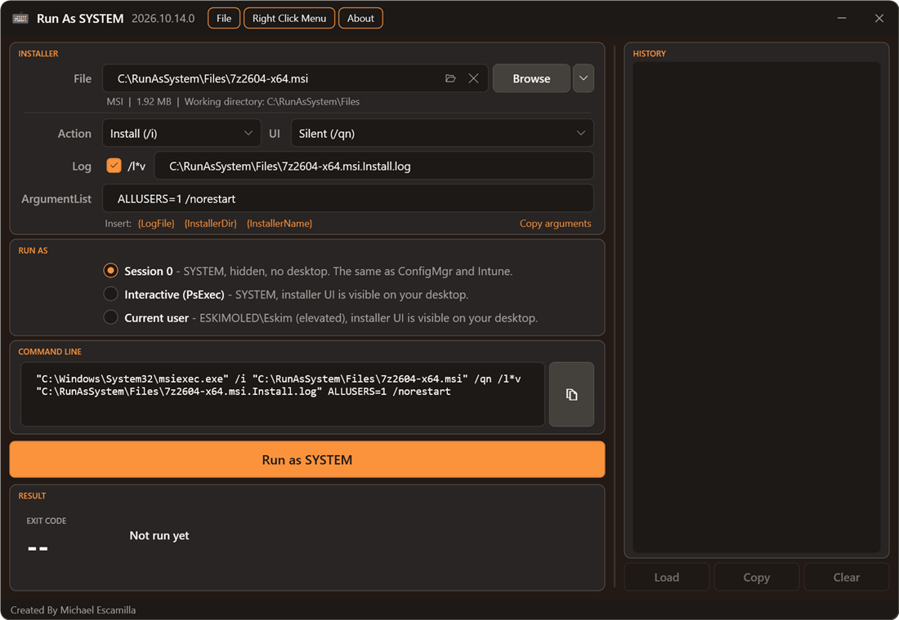
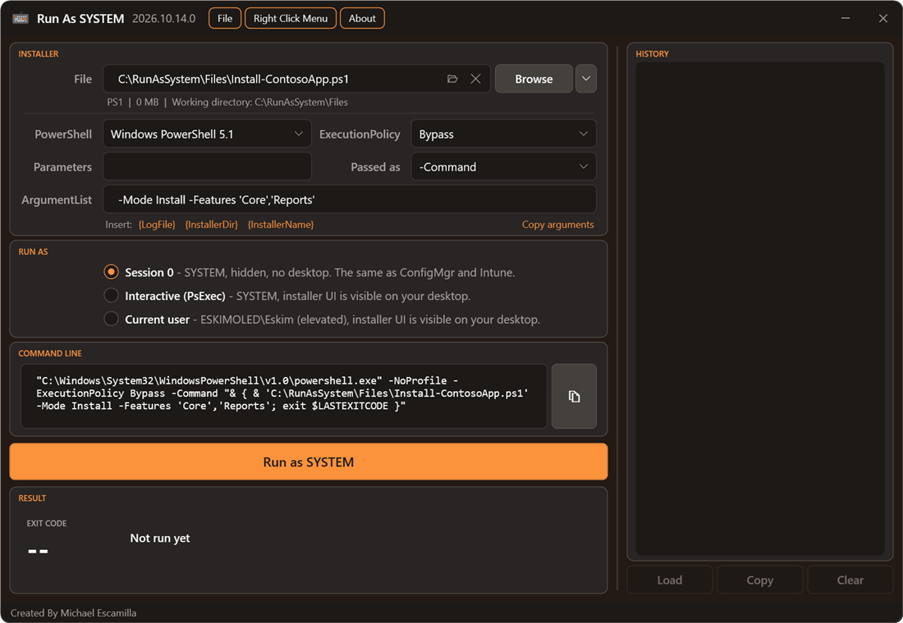
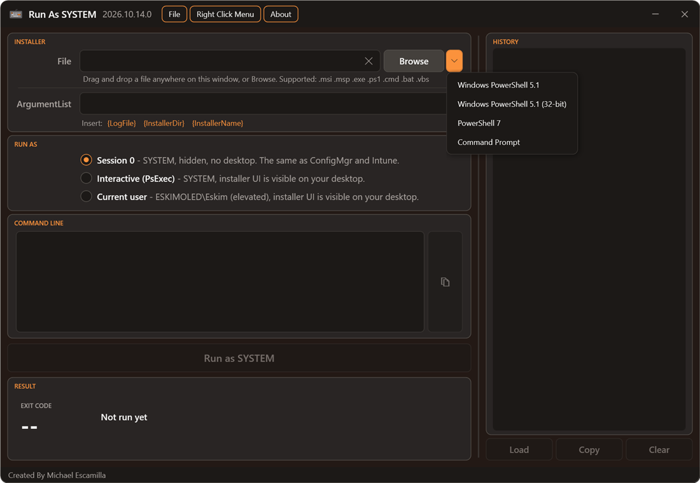
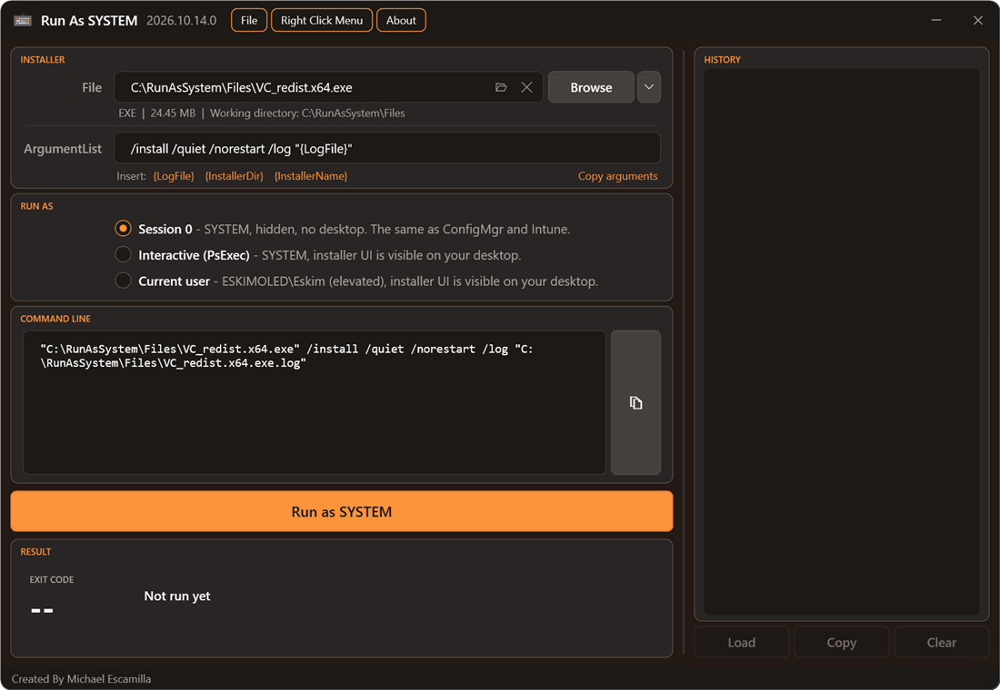

# File Types and Options

[RunAsSystem](../README.md) > File Types and Options

## Supported File Types

| Type | Runs as |
| --- | --- |
| `.msi` | `msiexec.exe /i` (or `/x`, `/fvomus`) `"file.msi"` + UI level, `/l*v` log and ArgumentList |
| `.msp` | `msiexec.exe /p "file.msp"` + the same options |
| `.exe` | The file itself, with your ArgumentList |
| `.ps1` | `powershell.exe -NoProfile -ExecutionPolicy Bypass -File "file.ps1"` + ArgumentList, by default. See [PS1 Options](#ps1-options) |
| `.cmd` / `.bat` | `cmd.exe /c ""file.cmd" arguments"` |
| `.vbs` | `cscript.exe //NoLogo "file.vbs"` + ArgumentList |

The installer's own folder is always used as the working directory, the same as ConfigMgr and Intune.

The **Command Line** box shows exactly what will run, and you can copy it with the copy button.

When you load a file of a different type, the options go back to their defaults (Install, Silent, log on, an empty ArgumentList and Session 0), since settings for one type rarely suit another. Loading another file of the same type keeps them.

## MSI Options

- **Action**: Install (`/i`), Uninstall (`/x`) or Repair (`/fvomus`).
- **UI**: Silent (`/qn`), Basic (`/qb`), Basic with no cancel (`/qb!`), Passive (`/passive`) or Full UI.
- **Log**: a verbose log (`/l*v`) is on by default. It's written next to the installer, named after the installer and the action: `Setup.msi.Install.log`, `Setup.msi.Uninstall.log`, `Setup.msi.Repair.log`, or `Update.msp.Patch.log` for a patch. Changing the action updates the name, unless you've typed your own path.
- **ArgumentList**: anything else to pass to msiexec, such as `ALLUSERS=1 TRANSFORMS="app.mst"` or `/norestart`.

## PS1 Options

A `.ps1` runs with Windows PowerShell 5.1 and `-File` by default, which is what Intune and ConfigMgr use. The PS1 options change that:

| Option | Choices |
| --- | --- |
| **PowerShell** | Windows PowerShell 5.1, Windows PowerShell 5.1 (32-bit), or PowerShell 7. PowerShell 7 is only offered when it's installed for all users, since SYSTEM can't reach a per-user or Store copy |
| **ExecutionPolicy** | Bypass (default), Unrestricted, RemoteSigned, AllSigned, or *Not set*, which leaves `-ExecutionPolicy` out so the device's policy applies |
| **Parameters** | Extra PowerShell parameters, added before `-File` or `-Command`, for example `-NonInteractive -WindowStyle Hidden` |
| **Passed as** | `-File`, `-Command` or `-EncodedCommand` (see below) |

How the ArgumentList reaches the script depends on **Passed as**:

- **`-File`**: Windows splits the ArgumentList, not PowerShell. Only double quotes group, single quotes are literal, and `'a','b'` isn't an array. This is how Intune and ConfigMgr pass it.
- **`-Command`**: the script is run with `&`, and PowerShell parses the ArgumentList. Arrays like `-Path 'C:\One','C:\Two'` and single quotes work. The script's `exit` code is passed through.
- **`-EncodedCommand`**: the same as `-Command`, sent as base64, so no quoting rules apply on the way.

The PS1 options are saved in history, and a history entry shows them when they aren't the defaults.

## Tools Menu

The arrow beside **Browse** fills the File box with a system program instead of an installer, to test something as SYSTEM:

- Windows PowerShell 5.1
- Windows PowerShell 5.1 (32-bit)
- PowerShell 7 (when it's installed for all users)
- Command Prompt

Tools are handled a little differently from installers:

- They run from `C:\Windows\Temp`, not their own folder, so nothing is written into System32.
- **Stop** only ends the copies started by the run, not other PowerShell or cmd windows that are open.
- PowerShell tools get the PS1 options. With **Passed as** set to `-Command` or `-EncodedCommand`, the ArgumentList is run as PowerShell code, for example `Get-ChildItem Cert:\LocalMachine\My`. With *As typed*, the ArgumentList is passed to the program unchanged, so you write the whole command (for example `-Command "whoami"`), and ExecutionPolicy and Parameters don't apply.
- With no arguments in Session 0, the app offers to switch to Interactive (PsExec), because a bare shell would wait for input with no window.

## Variables in ArgumentList

EXE installers each have their own log switch, so there's no log checkbox for them. Instead, the line under ArgumentList has variables you can click to insert at the cursor. They're filled in when the installer runs:

| Variable | Becomes |
| --- | --- |
| `{LogFile}` | A log file next to the installer: `C:\Pkgs\Setup.exe.log` |
| `{InstallerDir}` | The installer's folder, without a trailing backslash: `C:\Pkgs` |
| `{InstallerName}` | The installer's file name, with its extension: `Setup.exe` |

For example, `/log "{LogFile}"` for a WiX Burn bundle, `/LOG="{LogFile}"` for Inno Setup, or `/log "{InstallerDir}\{InstallerName}.Uninstall.log"` for your own name. The extension is kept so the logs of a product's EXE and MSI installers don't mix.

- These only fill in a path. The installer writes a log only if you pass the path with its own log switch, so check the vendor's documentation.
- When `{LogFile}` is in the arguments, **Open Log** opens that file once the installer creates it, the same as an MSI log. A path built from `{InstallerDir}` and `{InstallerName}` isn't followed.
- Hover over a variable to see the value it has for the loaded file.
- The Command Line box shows the values filled in. **Copy arguments** copies just the arguments with the values filled in.
- History saves the variables as you typed them, so loading a run works out the paths again.
