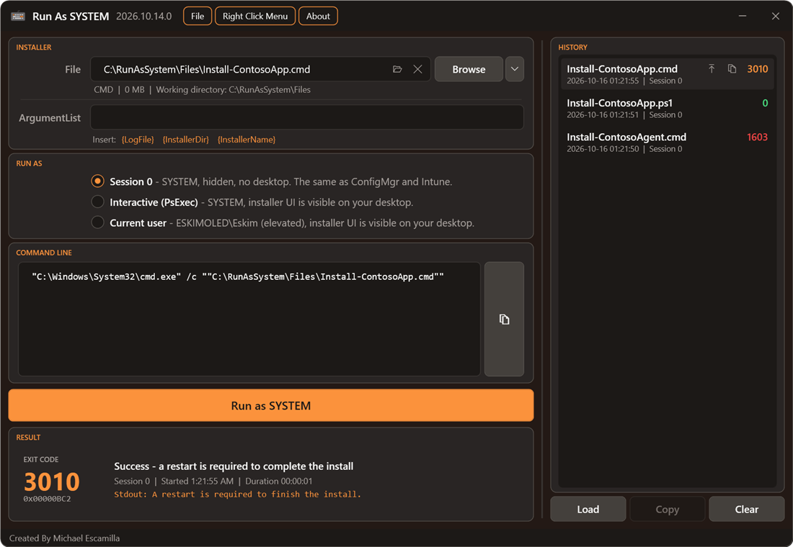

# History

[RunAsSystem](../README.md) > History

Every run is saved to `%LOCALAPPDATA%\RunAsSystem\History.json`. It keeps the last 50 runs, including runs launched with `iex`.

- Each entry shows the file, exit code, time, run mode and arguments, plus the PS1 options when they aren't the defaults.
- **Load** (or double-click a run, or the load icon that appears when you hover over a run) puts the file, options, arguments and run mode back into the form, ready to run again.
- **Copy** (or the copy icon on hover) copies the run's command line.
- **Clear** empties the history.

**File > Open History Folder** opens `%LOCALAPPDATA%\RunAsSystem`.

## Protected Arguments

Arguments can contain passwords or license keys, so the arguments and command line are encrypted with Windows DPAPI. Only your Windows account on that device can read them. If you copy `History.json` to another device, the runs still appear, but their arguments can't be loaded. Those entries show a warning icon.
