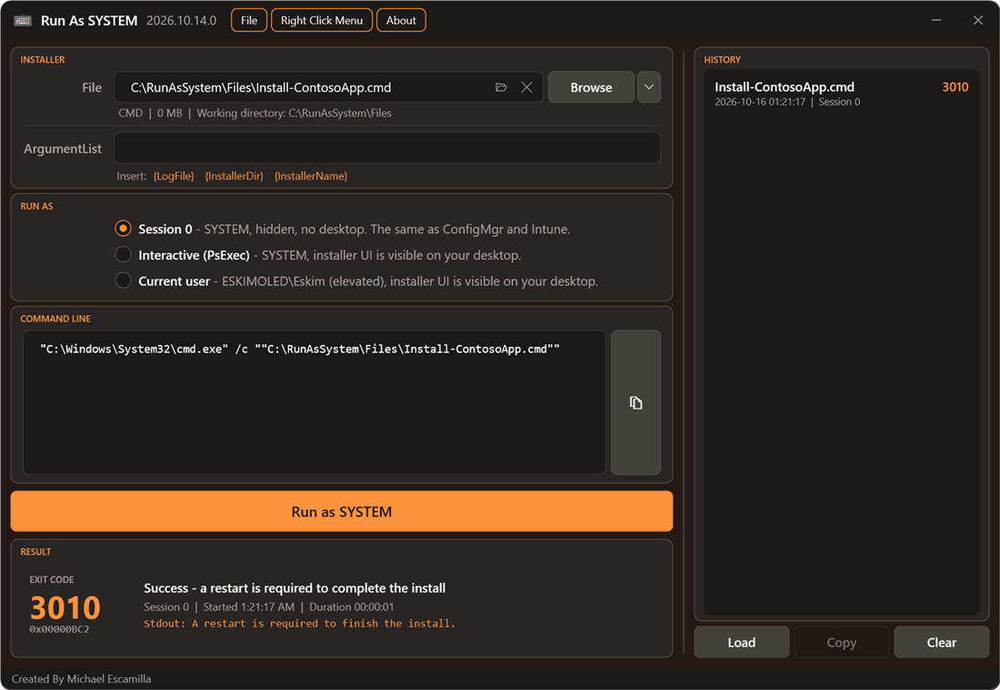
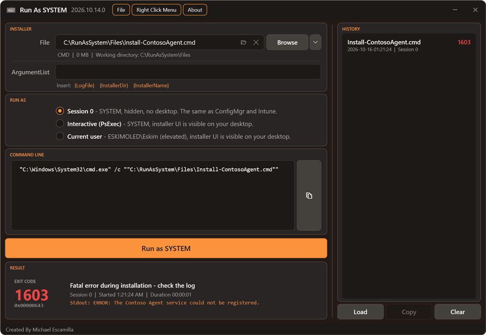
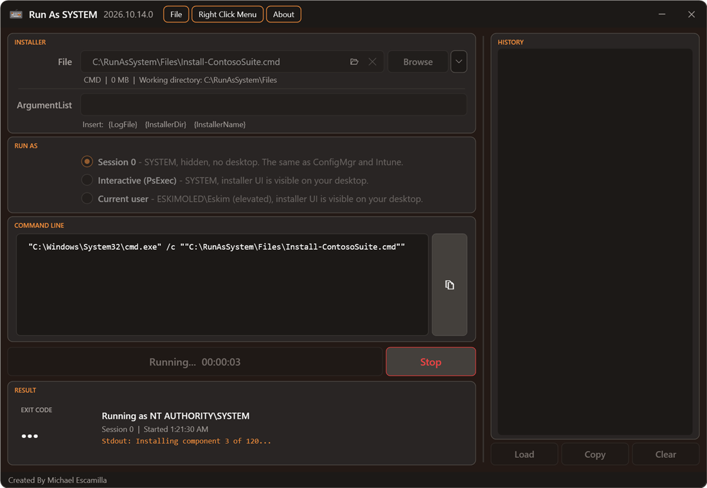

# Results

[RunAsSystem](../README.md) > Results

## Exit Codes

When the run finishes, the exit code is shown in colour:

- **Green**: success (`0`, `1707`).
- **Orange**: success with a restart required or started (`3010`, `1641`).
- **Red**: failure.
- **Grey**: the run was stopped.

Common Windows Installer codes (`1603`, `1618`, `1619`, `1638`, and others) have plain-English descriptions. Any other code falls back to the description Windows has for that number. The hex value is shown under the code (for example `0x80070002`), which is handy for EXE installers that document their codes in hex.

Click the exit code, or its hex value, to copy it for looking up.

## Captured Output

In Session 0 nobody can see the console, so whatever an EXE, PS1, CMD, BAT or VBS writes to stdout and stderr is saved to a file:

- The latest line is shown in the result as a **Stdout** line, updated while the installer runs.
- Click the Stdout line to open the full output.
- Outputs are saved in `%LOCALAPPDATA%\RunAsSystem\Output`, and the last 50 are kept.
- The installer's arguments and exit code are unchanged.

MSI and MSP runs aren't captured, because msiexec writes to its log instead. Interactive (PsExec) and Current User runs aren't captured either, because the console window is visible.

## Logs and Folders

- **Open Log** appears once there's a log to open: for an MSI or MSP run with logging on, or any run with `{LogFile}` in its arguments (see [Variables in ArgumentList](file-types.md#variables-in-argumentlist)). It shows as soon as the installer creates the log, so you can follow an install while it runs. The log opens in the default app for `.log` files.
- **Open Folder** is the folder icon in the File box. It opens the installer's folder, before or after a run.

## Stopping a Run

While a run is in progress, a **Stop** button appears next to Run. It works the same way for every file type and in every run mode. It ends the running process and anything it started, and records the run as **Stopped** in history. Stopping a process partway through can leave the software partly installed.

**MSI installs can't be stopped this way**, and neither can an MSI started by an EXE. The install runs in the Windows Installer service, not in the `msiexec.exe` process the tool starts. Windows Installer finishes the install in the background and keeps writing the log, and RunAsSystem just stops waiting. Starting another MSI before it finishes returns `1618`. Uninstall afterwards if you need to undo it.
