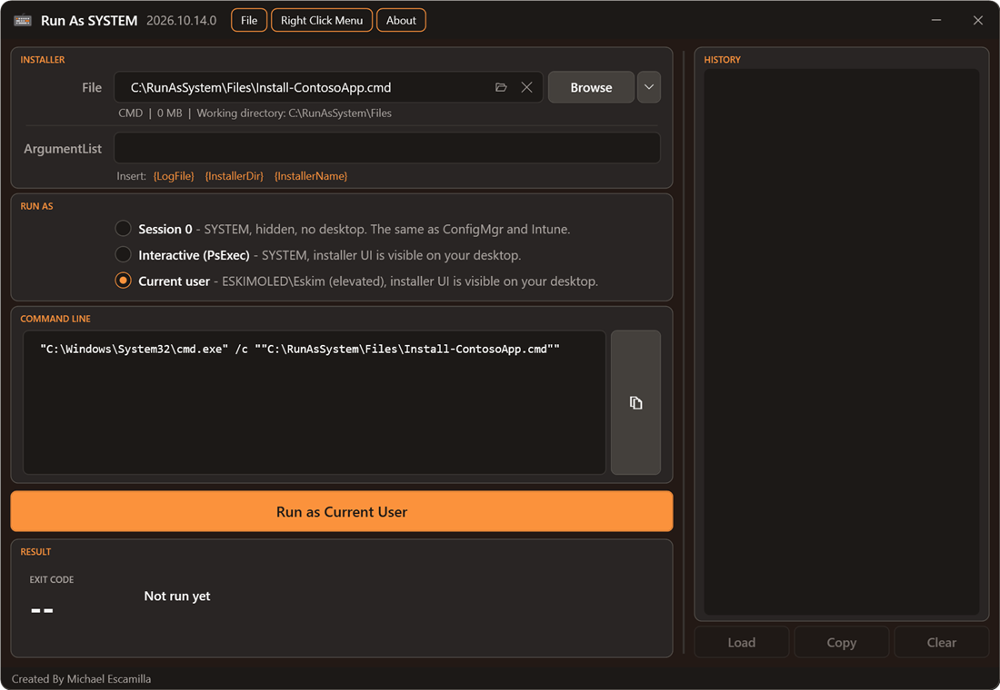

# Run Modes

[RunAsSystem](../README.md) > Run Modes

The **Run As** section picks who the installer runs as and where. The Run button's label changes to match.

| Mode | Runs as | Window | Best for |
| --- | --- | --- | --- |
| [Session 0](#session-0-default) (default) | SYSTEM | None | Testing exactly how ConfigMgr and Intune run it |
| [Interactive (PsExec)](#interactive-psexec) | SYSTEM | On your desktop | Seeing why a silent install hangs |
| [Current User](#current-user) | The account running RunAsSystem | On your desktop | Testing a user-context install |

## Session 0 (default)

The installer runs as SYSTEM in **session 0**, which has no desktop. This is how the ConfigMgr client and the Intune Management Extension run installers, so it's the most accurate test. Problems this mode catches:

- Installers that stop at a prompt or dialog nobody can see. In ConfigMgr and Intune these hang until they time out.
- Installers that depend on the logged-on user's profile, environment variables or mapped drives.

No PsExec is needed. A one-time Scheduled Task, based on the approach [Ben Whitmore](https://github.com/byteben) used in the [Patch My PC Connectivity tool](https://github.com/PatchMyPCTeam/CustomerTroubleshooting/tree/Release/PowerShell/Connectivity), runs the installer directly:

- The task is registered in the root of the Task Scheduler Library as `RunAsSystem_<timestamp>`.
- It runs as `S-1-5-18` with highest privileges at normal priority. Scheduled tasks default to below-normal priority, which would make installs run slower than they do in ConfigMgr or Intune.
- It has no active trigger, so it only runs when the tool starts it. It has no time limit, and its working directory is the installer's own folder.
- The installer's exit code becomes the task's *Last Run Result*, which is how the tool reads it.
- The task is deleted as soon as the run finishes. If the app is closed mid-run, the task expires and deletes itself after 24 hours, and the next launch of the app removes it anyway.

Nobody can see the console in Session 0, so for everything except MSI and MSP the installer's output is captured to a file. See [Captured Output](results.md#captured-output).

If you run PowerShell or Command Prompt from the [Tools menu](file-types.md#tools-menu) with no arguments in Session 0, it would sit waiting for input with no window to type into. The app offers to switch to Interactive (PsExec) instead, so you get a SYSTEM console.

## Interactive (PsExec)

The installer runs as SYSTEM **on your desktop**, so any installer UI is visible. This is useful for working out why a silent install hangs.

The tool looks for `PsExec64.exe` (or `PsExec.exe`) in `%LOCALAPPDATA%\RunAsSystem\PsExec` first, then on the `PATH`. If it isn't found, the tool offers to download it from [live.sysinternals.com](https://live.sysinternals.com) into `%LOCALAPPDATA%\RunAsSystem\PsExec`.

## Current User

The installer runs as **the account running RunAsSystem**, on your desktop, with the same elevation as RunAsSystem. Because the app always runs elevated, this normally means elevated. The option shows the account and its elevation, for example *CONTOSO\Admin (elevated)*.

It uses the same one-time Scheduled Task as Session 0 mode, registered for your account with an interactive token, so no password is needed. That means the exit code, cleanup and **Stop** work the same way.

Things to know:

- Intune and ConfigMgr run user-context installs **without** elevation, so this mode isn't an exact match for their user context. An installer that quietly needs admin rights will still succeed here.
- If you elevated RunAsSystem with a **different** admin account than the one you're signed in with, the installer runs as that admin account, not as you. An interactive task may not start at all for an account that isn't signed in to Windows. If it doesn't start within 30 seconds, the tool says so.

## Things to Know About SYSTEM

- **Network paths**: SYSTEM connects to shares as the computer account (`DOMAIN\COMPUTER$`). The share needs to allow read access for it, and write access too if the MSI log is written there. The app warns you when the installer is on a network path.
- **Mapped drives**: drive letters you mapped in your normal session aren't available to elevated apps or to SYSTEM. Use the UNC path instead. If the drive letter isn't found, the app reminds you of this.
- **Session 0 has no UI**: if an installer waits for input in Session 0, it waits forever. Switch to **Interactive (PsExec)** to see what it's waiting for, or use [Stop](results.md#stopping-a-run).
