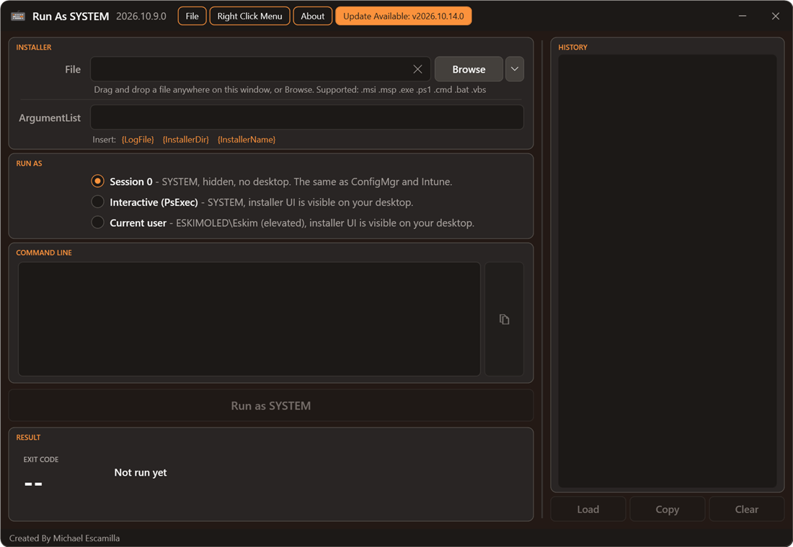

# Updates

[RunAsSystem](../README.md) > Updates

The app checks GitHub for a newer release after it opens. If one exists, an **Update Available** item appears in the menu bar. **About > Check for Updates** checks again on demand.

Clicking **Update Available** installs the update and reopens the app with the same file loaded. How it updates depends on how you started it:

| Started from | What happens |
| --- | --- |
| A downloaded copy of the script, or the right-click menu | The script file is replaced with the new release |
| The PowerShell Gallery (`Install-Script`) | The app runs `Update-Script RunAsSystem` |
| `iex (irm ...)` | The release page opens. Nothing is saved on disk, and the next launch is already the latest |

If the update can't be installed (you're offline, the file is locked or the download is damaged), the release page opens instead. You can't update while an installer is running.
